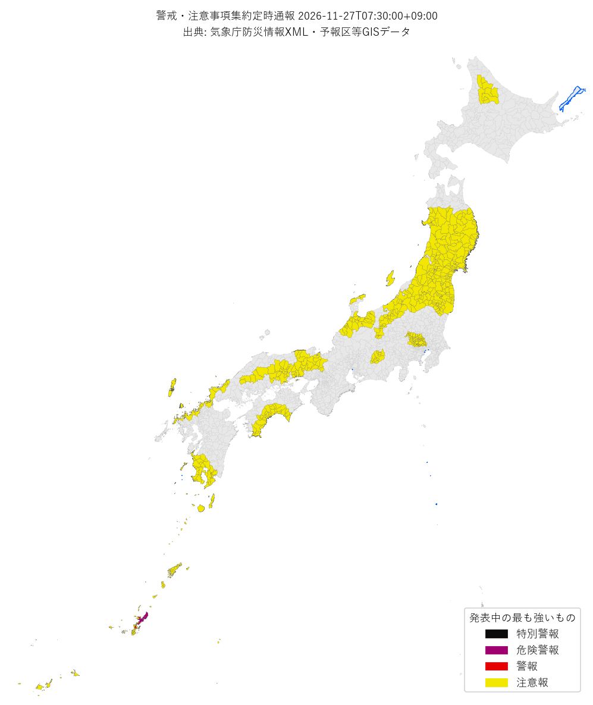

# 検証: 警報・注意報を市町村の面に変換できるか（2026年11月27日）

**結論: できる。** 集約通報（VPWS50）1通で、全国1,805の市町村等すべてを予報区等GISデータの面に結合できた。結合できないコードは電文側・GIS側とも0。

## 使ったもの

| もの | 中身 |
|---|---|
| 電文 | 気象警報・注意報（R06）（集約通報）VPWS50、2026-11-27 07:30 発表（1.1MB） |
| GIS | 予報区等GISデータ「市町村等（気象警報等）」`20260226_AreaInformationCity_weather_GIS.zip`（2026年5月下旬の防災気象情報の体系整理に伴う区域変更後の版） |
| 処理 | `src/jma_bosai_xml/warning.py`（電文を平らにする）、`scripts/verify_city_warnings.py`（結合・出力・地図） |

## 結果

| 項目 | 結果 |
|---|---|
| 電文の市町村等 | 1,805区域、1,913行（1区域に複数の警報・注意報があると複数行） |
| GIS の区域 | 1,821（うちコードあり 1,805、コードなし 16） |
| 電文にあって GIS にないコード | **0** |
| GIS にあって電文にないコード | **0** |
| 状態 | 発表警報・注意報はなし 1,224、継続 639、解除 50 |
| 発表中の最も強いもの | 危険警報 5、警報 3、注意報 523、なし 1,290 |

### 中身の確かめ

沖縄本島地方の個別の電文（R06 の大雨 VPWW55・土砂 VPWW56）と、集約通報の同じ市町村を突き合わせた。大雨14、土砂14の市町村・警報の名前がすべて一致した。状態が「発表」と「継続」で2件違うのは、発表時刻の差による（個別の電文 05:51・06:40、集約通報 07:30）。

## わかったこと

1. **GIS の区域のうち16にはコードがない。** 北方領土（色丹島・国後島・択捉島）、境界が決まっていない埋立地（荒川河口部、名古屋港口埋立地など）、鳥島などの離島。警報の発表区域ではないので、結合できなくて正しい。
2. **名前はコードほど当てにならない。** 17区域で電文と GIS の名前が違うが、すべて政令市の区の書き方の違い（電文「神戸市東灘区」、GIS の regionname「兵庫県神戸市東灘区」）。結合はコードだけで行う。
3. **R06 系は、警報が出ていない区域も「発表警報・注意報はなし」として載る。** 地図に空白の区域が出ない。
4. **警報の名前にレベルが入っている。** 「レベル４大雨危険警報」「レベル３大雨警報」「レベル２土砂災害注意報」など。レベルの数字と、語尾（特別警報・危険警報・警報・注意報）で区分を読み取れる。読み取るだけで、電文の値は変えない。
5. **電文の種類名は管理部の Title にある。** ヘッダ部の Title は見出し（「東京都暴風（雪）警報・注意報」）。両方残す（`telegram_type` と `title`）。
6. **予報区等GISデータの Shapefile には .prj がなく、属性は UTF-8。** 座標系は配布ページに「世界測地系（JGD2011）」とある（EPSG:6668 として扱う）。読み込むときに文字コードを指定しないと文字化けする。
7. **GIS は区域の版を合わせる必要がある。** 「市町村等（気象警報等）」は、2026年3月（神戸市の区域変更）、2026年5月下旬（防災気象情報の体系整理）で区域が変わり、版が3つ配布されている。今回は最新版で全コードが一致した。過去の電文を変換するときは、発表日時に合った版を使う。

## 課題

- **ジオメトリが重い。** 簡略化しない GeoParquet は 200MB、0.002度で簡略化した GeoJSON でも 29MB。区域の形はほぼ変わらないので、形（境界）と警報（属性の表）を分けて持ち、使う側でコードで結合するほうがよい。表示用には PMTiles を作る。
- **集約通報は定時（約10分ごと）。** 個別の電文より遅れることがある。急いで知りたい用途では、個別の電文（VPWW55〜61）を合わせる必要がある。
- まだ試していないもの: 旧系統（VPWW53/54）、市町村以外の階層（一次細分区域、市町村等をまとめた地域）、複数の電文を合わせた全国の状態づくり、過去の電文の変換。

出典: 気象庁防災情報XML、気象庁「予報区等GISデータ」
